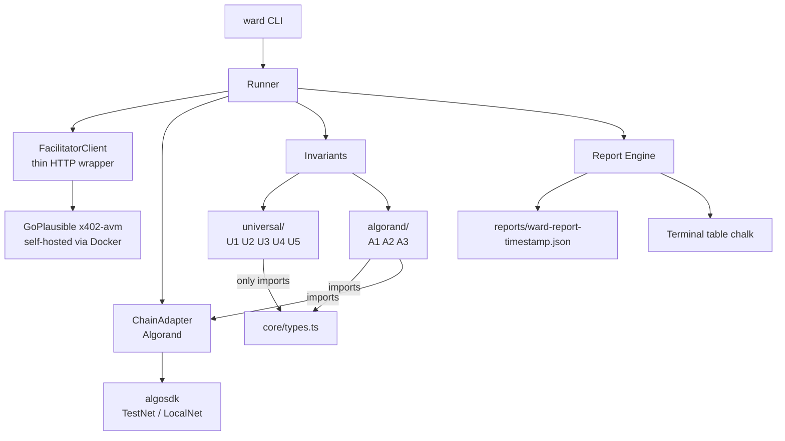

<p align="center">
  


</p>

<h1 align="center">AlgoWard</h1>

<p align="center">
  <strong>Adversarial conformance testing for x402 payment facilitators — Algorand first.</strong>
</p>

<p align="center">
  <a href="https://github.com/debojyoti10CC/alg402/actions"></a>
  <a href="https://github.com/GoPlausible/x402-avm"></a>
  <a href="https://x402.org"></a>
  <a href="https://x.com/algoward"></a>
</p>

---

## At a Glance

- Run `ward init` — boots a real, self-hosted facilitator over Docker, funds test accounts, fires one live payment to confirm the stack is working.
- Run `ward test` — executes every must-have invariant against that live facilitator, writes a machine-readable JSON report, exits non-zero on any failure.
- Run `ward fuzz A1` — isolates one invariant in verbose mode: prints the full payload, every tamper operation, and the facilitator's exact response.
- Run `ward report` — re-renders the last run's findings as a table, no facilitator required.

Eight invariants. Five must-have. Three stretch. Every finding cites the protocol spec or study section it tests — no hand-wavy "best practices".

---

## Problem

A USENIX Security '26 study audited 15 major x402 facilitators — covering 60,000+ sellers and 360,000+ buyers — and found authorization-correctness violations in **every single one**, across four classes:

| Violation Class | What it enables |
|---|---|
| **Free Shopping** | Buyer receives goods without a valid, settled payment |
| **Asset Theft** | Payment redirected to an attacker-controlled address |
| **Service Denial** | Legitimate payments rejected by a poisoned or exhausted state |
| **Gas Abuse** | Facilitator's operational keys drained through crafted fee resubmissions |

No facilitator ships with an automated way to test for these. Developers deploying x402 infrastructure have no way to know which guarantees their facilitator actually provides — only which ones it claims to.

Ward is the test framework that closes that gap.

---

## Solution

Ward compiles the study's four violation classes — plus three Algorand-specific invariants that exploit the AVM's atomic group model — into reproducible, executable adversarial scenarios. Each one runs against a real, self-hosted facilitator process that Ward controls end to end.

No shared or production infrastructure is ever touched. Every invariant's `source` field cites exactly what it tests — protocol spec section, study finding, or AVM primitive — so any failure comes with a traceable claim, not an assertion.

The core is chain-agnostic by construction. `invariants/universal/*` only imports from `core/types.ts`. Adding a second chain means writing a new adapter under `chain-adapters/<chain>/` — the universal invariants don't change.

---

## Invariants

| ID | Name | Category | Priority | Source |
|----|------|----------|----------|--------|
| **U1** | Verify/settle consistency | universal | must-have | x402 spec; USENIX — Free Shopping, Asset Theft |
| **U2** | Retry safety | universal | must-have | x402 spec; USENIX — Free Shopping via naive retries |
| **U3** | Concurrent double-settle | universal | must-have | USENIX — concurrency races enabling double-settlement |
| **U4** | Allowlist enforcement | universal | must-have | x402 spec — `/supported` must be authoritative |
| **A1** | Atomic group integrity | algorand | **headline / must-have** | AVM atomic groups; `@x402/avm verifyFeePayerTransaction`; all four USENIX classes |
| U5 | Gas abuse resubmission | universal | stretch | USENIX — Gas Abuse |
| A2 | ASA opt-in precheck | algorand | stretch | Algorand ASA opt-in requirement |
| A3 | Rekey authorization | algorand | stretch | Algorand rekeying; settle-time re-verification |

### A1 — the headline invariant

The `@x402/avm` facilitator's gasless flow assembles a 2-transaction atomic group: the client's *signed* payment (index 1) plus an *unsigned* fee-payer self-payment (index 0) that only the facilitator signs at verify/settle time. Because that second leg is never signed by the client, a payload intercepted after authorization can be rewritten — inflated amount, redirected receiver, `rekeyTo` injection, `closeRemainderTo` drain — while keeping the original group ID intact.

A1 proves the facilitator's `verifyFeePayerTransaction` check catches all five variants, mapped directly onto the USENIX study's violation classes. The malicious sub-cases use `/verify` only — never `/settle` — so the same code path is exercised without ever broadcasting a tampered transaction to the network.

---

## Architecture



```
src/
├── cli/                    commander entrypoint — init, test, fuzz, report
├── core/                   Invariant, ChainAdapter, FacilitatorClient interfaces
│                           registry, sequential + concurrent runner, report engine
├── facilitator-client/     thin HTTP wrapper: verify(), settle(), supported()
├── invariants/
│   ├── universal/          U1–U5 — only allowed to import core/types.ts
│   └── algorand/           A1–A3 — the only files that import chain-adapters/algorand/
└── chain-adapters/
    └── algorand/           algosdk payload construction + tamper helpers
        ├── algorand-adapter.ts
        ├── tx-builder.ts
        ├── atomic-group.ts   reorder/alter group members for A1
        ├── asa.ts            opt-in state helpers for A2
        └── rekey.ts          rekey simulation for A3
```

The rule that makes "chain-agnostic" real rather than a pitch claim: `invariants/universal/*` may never import `chain-adapters/algorand/*` directly — only `core/types.ts` and `invariants/shared.ts`. Linting enforces this boundary.

---

## CLI

| Command | Exit | Behavior |
|---|---|---|
| `ward init` | non-zero on failure | Boots the facilitator via Docker Compose, auto-funds test accounts, fires one live payment end to end. Idempotent — safe to re-run. |
| `ward test` | non-zero if any must-have fails | Runs the full invariant suite. Writes `reports/ward-report-<timestamp>.json` and `reports/latest.json`. |
| `ward fuzz <id>` | non-zero on fail | Runs one invariant in isolation, always verbose. Full request/response printed, not just a summary. |
| `ward report` | 0 always | Re-renders `reports/latest.json` as a table. No live facilitator required. |

---

## Sample Output

```
$ ward fuzz A1

Fuzzing A1 — atomic group integrity
Source: Algorand atomic transaction groups · @x402/avm verifyFeePayerTransaction
        USENIX Security '26 — Free Shopping, Asset Theft, Service Denial, Gas Abuse
Category: algorand

  ✔  fee-payer leg amount > 0 (drains value instead of a pure self-payment)
  ✔  fee-payer leg receiver redirected away from self
  ✔  fee-payer leg closes remainder balance to a third party
  ✔  fee-payer leg rekeys the facilitator's own account
  ✔  fee-payer leg fee inflated far past the reasonable cap

Result: PASS  (2143ms)
```

```
$ ward test

Ward · 5/5 must-have invariants
──────────────────────────────────────────
  ✔  U1  verify/settle consistency        (891ms)
  ✔  U2  retry safety                     (1204ms)
  ✔  U3  concurrent double-settle         (3317ms)
  ✔  U4  allowlist enforcement            (443ms)
  ✔  A1  atomic group integrity           (2143ms)
  –  U5  gas abuse resubmission           skipped (stretch)
  –  A2  ASA opt-in precheck              skipped (stretch)
  –  A3  rekey authorization              skipped (stretch)
──────────────────────────────────────────
PASSED  5/5 must-have  ·  report → reports/latest.json
```

---

## How to Run

### Prerequisites

- Node.js 20+
- Docker + Docker Compose (for `ward init`)
- Python 3 (optional — only needed to validate `launch_spec.json`)

### Setup

```bash
cp .env.example .env
npx tsx scripts/fund-accounts.ts
```

The funding script generates every keypair `.env` needs and prints their addresses. Fund `WARD_FUNDER` and `AVM_PRIVATE_KEY`'s addresses via the [TestNet ALGO dispenser](https://bank.testnet.algorand.network/) — this captcha-gated step cannot be automated (see `DECISIONS.md` D9).

```bash
npm install
npm run ward -- init    # boots facilitator, auto-funds the rest, verifies one real payment
npm run ward -- test    # full invariant suite
```

Or, once built:

```bash
npm run build
ward init && ward test
```

---

## Facilitator

Ward runs against [GoPlausible's `x402-avm`](https://github.com/GoPlausible/x402-avm) (`branch-v2-algorand-publish` — the branch since adopted into the official `x402-foundation/x402` monorepo). It is self-hosted via `docker-compose.yml`, not the public `facilitator.goplausible.xyz` instance.

Every wire shape Ward relies on — `PaymentRequirements`, `PaymentPayload`, the fee-abstraction group layout, `verify()`/`settle()` algorithm, and error codes — was read directly from the installed `@x402/core` and `@x402/avm` package source (`.d.mts` and compiled `.mjs`), not inferred from reference docs, which diverge in several places (see `DECISIONS.md` D7).

---

## Comparison

| Capability | Manual QA | Protocol docs | Generic HTTP test suite | **Ward** |
|---|---|---|---|---|
| Tests against a real, live facilitator | Sometimes | Never | Sometimes | Always |
| Covers concurrency races | Rarely | Never | No | Yes — deterministic dispatch |
| Algorand atomic group tamper tests | No | No | No | Yes — 5 sub-cases |
| Cites violation class per finding | No | Spec only | No | Yes — USENIX study |
| Machine-readable JSON report | No | No | Depends | Yes — CI-ready |
| Chain-agnostic core | N/A | N/A | Yes | Yes — adapter pattern |

---

## Tech Stack

| Layer | Choice |
|---|---|
| Language | TypeScript (strict) |
| CLI | Commander.js |
| Algorand SDK | `algosdk` |
| x402 packages | `@x402/core`, `@x402/avm` |
| Facilitator | GoPlausible `x402-avm` (Docker) |
| Network | Algorand TestNet (or LocalNet via `docker-compose.yml`) |
| Output | `chalk` (terminal), JSON (machine-readable) |
| Report rendering | `cli-table3`, `ora` |

---

## Report Format

The JSON report is CI-pipeline-ready (`ward test` exits non-zero on any must-have failure):

```json
{
  "runId": "uuid",
  "timestamp": "2025-11-14T09:23:07Z",
  "facilitator": {
    "name": "x402-avm",
    "commit": "abc1234",
    "chain": "algorand-testnet"
  },
  "results": [],
  "summary": {
    "total": 8,
    "passed": 5,
    "failed": 0,
    "skipped": 3
  }
}
```

`ward report` re-renders this from disk — the live facilitator does not need to be running.

---

## Cut Order Under Time Pressure

If shipping under a hard deadline: cut **A3 → A2 → U5**, in that order. Never cut **U3** or **A1**. A flaky headline finding is worse than a smaller, bulletproof suite.

---

## Future Scope

- Open the chain-adapter interface to a second chain — universal invariants require no changes.
- Add a `/supported` diff-over-time tracker: detect when a facilitator quietly narrows its allowlist between runs.
- Publish Ward findings as a structured attestation artifact against a facilitator's commit hash.
- Extend A1 to cover the case where the fee-payer leg is removed from the group entirely, not just altered.

---

## Team

**Ward** — built for the x402 Global Hackathon

---

## Repository Structure

| Path | Purpose |
|---|---|
| `src/cli/` | CLI entrypoint — `init`, `test`, `fuzz`, `report` commands |
| `src/core/` | Chain-agnostic types, registry, runner, report engine |
| `src/facilitator-client/` | Thin HTTP wrapper over the facilitator's REST API |
| `src/invariants/universal/` | U1–U5 — no Algorand imports allowed |
| `src/invariants/algorand/` | A1–A3 — Algorand-specific invariants |
| `src/chain-adapters/algorand/` | algosdk payload construction and tamper helpers |
| `src/util/` | Logger, deterministic timing, evidence capture |
| `scripts/` | Account funding, manual payment verification |
| `reports/` | Ward output — gitignored except `.gitkeep` |
| `project_frg/` | Issuance package (8 validated documents) |
| `DECISIONS.md` | Architectural decisions and rationale — start here if anything looks surprising |
| `docker-compose.yml` | Facilitator + algod/indexer for local runs |
| `.env.example` | All required environment variables with documentation |

---

> Ward runs against a self-hosted facilitator process it controls. No test ever touches shared or production infrastructure. Confirm `docker-compose.yml` talks only to TestNet or LocalNet before running in any shared environment.
